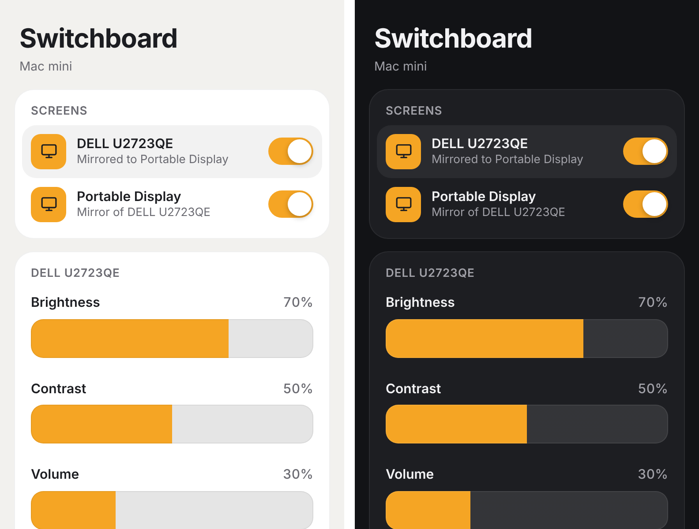

<p align="center">
  
</p>

<h1 align="center">Switchboard</h1>

<p align="center">
  A menu-bar control panel for external displays on Apple Silicon Macs.<br>
  Power, brightness, contrast, volume and resolution for every screen, from the menu bar, the keyboard, or your iPhone.
</p>

<p align="center">
  <a href="https://github.com/BireshwarChakravarty/SwitchBoard/actions/workflows/ci.yml"></a>
  <a href="https://github.com/BireshwarChakravarty/SwitchBoard/releases/latest"></a>
  
  
  <a href="LICENSE"></a>
</p>

---

macOS gives an external monitor almost no controls: no power switch, no
brightness, and on a Mac mini the keyboard's brightness keys only report "not
supported". Switchboard talks to monitors directly over **DDC/CI**, the
control channel built into DisplayPort, HDMI and USB-C, and falls back to
software where a monitor doesn't support it.

It's a native SwiftUI app with the macOS 26 Liquid Glass design, with no
third-party dependencies.

## Features

- **Power.** Switch any external screen off and on. DDC/CI monitors go into
  hardware standby; monitors without it, such as many portable displays, are
  disconnected in software. Other screens stay on either way. Optionally
  switch screens off while the Mac is locked or asleep.
- **Picture.** One brightness slider that drives the backlight and continues
  below its minimum with software dimming, plus contrast, monitor speaker
  volume and resolution. An All Screens slider, and a brightness for Light and
  Dark mode each. Monitors without DDC/CI are left alone (power only), or
  dimmed in software if you choose.
- **Keyboard.** Brightness keys work on external displays, including Apple
  keyboards' F1 and F2, with an on-screen indicator. Volume keys control
  monitor speakers, which macOS can't adjust over HDMI or DisplayPort.
- **iPhone and Siri.** An optional remote on your local network: a Home Screen
  web app with the same controls, and ready-made Siri shortcuts such as
  "Portable Display Off" or "Screen Brightness".
- **Safe by design.** Nothing can get stuck: a disconnected screen comes back
  when Switchboard quits, even after a crash, and the last screen that's on
  can't be switched off.

<p align="center">
  
</p>

## Requirements

| | |
|---|---|
| **Mac** | Apple Silicon. Designed for Macs without a built-in display, such as Mac mini. |
| **macOS** | 26 (Tahoe) or later |
| **Monitors** | Any external display. Hardware controls need DDC/CI, which most monitors support; some ship with it turned off in their on-screen menu, and some docks and adapters don't pass it through. |

## Installation

Download **Switchboard.zip** from the
[latest release](https://github.com/BireshwarChakravarty/SwitchBoard/releases/latest),
unzip it, and move **Switchboard.app** to Applications. The app is ad-hoc
signed rather than notarized, so the first time, right-click it and choose
**Open**.

Or install (and later update) from Terminal:

```bash
pkill -x Switchboard; rm -rf /Applications/Switchboard.app && curl -L -o ~/Downloads/Switchboard.zip https://github.com/BireshwarChakravarty/SwitchBoard/releases/latest/download/Switchboard.zip && unzip -o ~/Downloads/Switchboard.zip -d /Applications && xattr -dr com.apple.quarantine /Applications/Switchboard.app && open /Applications/Switchboard.app
```

Updates keep your settings and permissions. The menu's footer shows the
installed version.

## Getting started

Switchboard lives in the menu bar: look for the monitor with a switch on its
screen. On first launch it turns on **Start at Login** and asks for two
permissions, which only the keyboard keys need:

| Permission | Why |
|---|---|
| **Input Monitoring** | Reads Apple keyboards' brightness keys, which macOS handles inside its keyboard driver. |
| **Device Control and Data Access** (Accessibility before macOS 27) | Handles volume keys, and brightness keys from keyboards that send them as standard events. |

Turn **Switchboard** on in both lists under System Settings → Privacy &
Security. The keys start working within seconds, without a relaunch.

> [!TIP]
> Quit other display utilities such as BetterDisplay, MonitorControl or Lunar
> while using Switchboard. They respond to the same keys and talk to the same
> monitors.

## Using Switchboard

### The menu

| Section | What it does |
|---|---|
| **Screens** | Every connected screen, its status (*Mirrored to …*, *Disconnected*) and a power switch. Click a screen to show its controls. The last screen that's on has no switch. |
| **Selected screen** | Brightness, Contrast, Volume and Resolution. **⋯** shows the screen's options. |
| **Brightness · All Screens** | One slider for every screen, when two or more can be adjusted. |
| **Settings** | Keyboard Keys, Match Light & Dark Mode, Start at Login, iPhone Remote, and Reset to Defaults. |

### Screen options

Open them with **⋯** on the selected screen, or by right-clicking a screen.

| Option | Description |
|---|---|
| **Switch Off By** | **Standby** (the monitor sleeps, over DDC/CI) or **Disconnect** (macOS stops using the screen, as if unplugged). Switchboard switches to Disconnect by itself the first time a monitor doesn't answer DDC/CI. |
| **Switch off while locked or asleep** | And back on when you unlock. |
| **Hide power switch** | For a screen you never turn off. Its switch is also unavailable remotely. |
| **Dim in software** | Monitors without DDC/CI only. Off by default: Switchboard then only switches the monitor on and off, and never touches its picture; set its brightness with its own buttons. Turn it on to get a brightness slider that darkens the picture in software. |

### Keyboard keys

| Keys | Action |
|---|---|
| Brightness up / down (<kbd>F1</kbd> / <kbd>F2</kbd> on Apple keyboards) | One of 16 steps, like a built-in display. Hold to repeat. |
| <kbd>⇧</kbd><kbd>⌥</kbd> + brightness | One of 64 steps |
| <kbd>fn</kbd> + <kbd>F1</kbd> / <kbd>F2</kbd> | Standard F1 and F2 (reversed if *Use F1, F2, etc. keys as standard function keys* is on) |
| Volume up / down, mute | Monitor speakers, when sound plays through them; otherwise the keys work as usual |

Brightness keys adjust the screen under the pointer and any screen mirroring
it. On Apple keyboards, macOS may still show its own "not supported" indicator
alongside Switchboard's.

### iPhone remote and Siri

1. On the Mac, turn on **Settings → iPhone Remote**. It shows an address such
   as `http://Mac-mini.local:8723` and a six-digit pairing code.
2. On an iPhone on the same Wi-Fi, open the address in Safari and enter the
   code.
3. Choose **Share → Add to Home Screen** to use it like an app. If the icon
   shows as a letter, open **Home Screen Icon** at the bottom of the page and
   install the profile instead; it adds the same web app with the icon.

For Siri, click **Add Shortcuts…** under iPhone Remote. Switchboard builds
"*Screen* On", "*Screen* Off" and "Toggle *Screen*" for each screen with a
power switch, plus "Screen Brightness", signs them, and opens them in the
Shortcuts app. Add each one; iCloud syncs them to your iPhone, where they also
work from Control Center and the Action button. Signing needs the Mac to be
signed in to iCloud.

The remote is off until you turn it on, only listens on your local network,
and only paired devices can use it. **Forget All** unpairs every device. To
build your own shortcuts or integrations, see the
[remote API reference](docs/remote-api.md).

### Reset to Defaults

**Settings → Reset to Defaults** reconnects every screen, wakes monitors from
standby, removes software dimming, sets each DDC/CI monitor's contrast to 50%
(the usual factory value), turns the remote off and forgets all settings.
DDC/CI's own factory-reset commands are optional and most monitors ignore
them; to reset a monitor completely, use its on-screen menu.

## Troubleshooting

Switchboard logs to the macOS unified log. To watch it while you reproduce a
problem:

```bash
log stream --level debug --predicate 'subsystem == "app.switchboard.Switchboard"'
```

| Problem | What to do |
|---|---|
| Keyboard keys do nothing | Check **Settings → Keyboard Keys** for a permission notice; it links to the right page. Quit other display utilities. |
| *Not responding to DDC/CI* | Turn on DDC/CI in the monitor's menu, or try another cable, port or adapter. Monitors without DDC/CI are switched off by disconnecting. |
| No brightness slider for a monitor | It doesn't support DDC/CI, so Switchboard leaves its brightness to its own buttons. Turn on **Dim in software** in its options for a software slider. Look for `No reply reading VCP` in the log to confirm. |
| A portable monitor's own brightness resets after it's switched off | Switching off cuts its video signal, and some portable monitors reset their brightness when they wake, especially when powered only over USB-C from the Mac. Give it its own power supply, or turn off any power-saving mode in its menu. |
| A control affects the wrong monitor | Each DDC/CI lookup logs the candidate ports with their EDID match scores. [Open an issue](https://github.com/BireshwarChakravarty/SwitchBoard/issues/new/choose) with those lines. |
| The iPhone can't reach the remote | Check the iPhone is on the same Wi-Fi and the Mac is awake. Try the numeric address shown in Settings, and allow incoming connections for Switchboard if the firewall asks. |
| *Couldn't make shortcuts* | Sign in to iCloud on the Mac (System Settings → your name) and try again. |
| The main monitor blinks when a mirroring screen switches off or on | macOS is probably changing the main monitor's refresh rate as the mirror changes, which makes the monitor re-sync. Set the main monitor to its native refresh rate in System Settings → Displays. For example, a 160 Hz monitor mirrored to a 144 Hz portable display blinked at 120 Hz but not at 160 Hz. |
| A screen stays off | Quit Switchboard and macOS reconnects it. Otherwise run `/Applications/Switchboard.app/Contents/MacOS/Switchboard --reset`, or log out and back in. |

## Privacy and security

- **No data collection.** Switchboard never contacts the internet. The optional
  remote serves only your local network while it's on; its traffic is
  unencrypted HTTP, so use it on a network you trust. Pairing keys are random
  256-bit values, stored only as SHA-256 hashes.
- **Narrow keyboard access.** Only brightness, volume and mute keys are acted
  on. Every other key passes through untouched and is never stored or logged.
- **Undocumented interfaces.** DDC/CI on Apple Silicon and the software
  disconnect use private macOS functions. A future macOS update could disable
  those features; the rest of the app would keep working.

See [SECURITY.md](SECURITY.md) to report a vulnerability.

## Uninstalling

Quit Switchboard from its menu (this restores every screen), then run:

```bash
rm -rf /Applications/Switchboard.app ~/Downloads/"Switchboard Shortcuts"
defaults delete app.switchboard.Switchboard
tccutil reset Accessibility app.switchboard.Switchboard
tccutil reset ListenEvent app.switchboard.Switchboard
```

Remove any **Switchboard** entry left in System Settings → General → Login
Items, and any Switchboard shortcuts from the Shortcuts app.

## Development

Switchboard builds with the free Command Line Tools; full Xcode isn't needed.

```bash
git clone https://github.com/BireshwarChakravarty/SwitchBoard.git
cd SwitchBoard
make test      # unit tests
make install   # build, then cleanly install into /Applications
```

Run `make help` for every task. [docs/architecture.md](docs/architecture.md)
explains how the app is put together, and
[CONTRIBUTING.md](CONTRIBUTING.md) covers guidelines, pull requests and
releases.

## Versioning

Switchboard follows [Semantic Versioning](https://semver.org/). Every release
is listed in the [changelog](CHANGELOG.md) and on the
[releases page](https://github.com/BireshwarChakravarty/SwitchBoard/releases).

## License

Released under the [MIT License](LICENSE). Switchboard is an independent
project, not affiliated with Apple, BetterDisplay, MonitorControl or Lunar.
