<p align="center">
  
</p>

<h1 align="center">Switchboard</h1>

<p align="center">
  A menu-bar control panel for the monitors on a Mac mini.
</p>

---

Switchboard gives every external screen a **switch** and a set of **faders**:

- **Switch screens off and on.** Monitors that support DDC/CI go into
  hardware standby. Monitors that don't (common on portable monitors) are
  disconnected in software, as if the cable were pulled, and reconnected when
  you switch them back on. You can choose **Black Out** for a screen instead.
- **Combined brightness.** One brightness slider per screen: the monitor's
  real backlight over DDC/CI, continuing below its minimum with software
  dimming. Monitors without DDC/CI are dimmed in software. An **All Screens**
  slider moves every screen together.
- **Contrast and volume** over DDC/CI, with live readouts.
- **Resolution slider** with the scaled sizes System Settings offers (HiDPI
  preferred), applied when you let go.
- **Your keyboard's brightness keys work.** On a Mac mini macOS says "not
  supported"; with Switchboard they adjust the monitor under the pointer
  (and any screen mirroring it), with an on-screen indicator. Hold ⇧⌥ for
  finer steps.
- **Volume keys for monitor speakers.** When sound plays through a monitor
  over HDMI or DisplayPort, which macOS can't adjust, the volume and mute keys
  control the monitor's own volume.
- **Match Light & Dark Mode:** each screen remembers a brightness for Light
  mode and one for Dark mode, and switches when macOS does, including on its
  Auto schedule. The app itself follows the system appearance too.
- **Off while locked or asleep:** per screen, switch it off when the Mac locks
  or sleeps and back on when you return.
- **Mirroring-aware:** shows "Mirrored to …" / "Mirror of …" like the system
  does.
- **Safe by design:** the last screen still on has no switch, Quit reconnects
  everything, and a crash or logout can never leave a screen stuck off.
- **Reset to Defaults** puts every screen back to normal and forgets all
  settings.

It's a native SwiftUI app with the macOS 26 Liquid Glass look, with no
dependencies and no network access.

## Requirements

- An **Apple Silicon Mac mini**. Switchboard is built for Macs without a
  screen of their own (it also runs on a Mac Studio). It isn't meant for
  MacBooks or iMacs.
- **macOS 26 (Tahoe)** or later.
- The Swift toolchain: the free **Command Line Tools** are enough
  (`xcode-select --install`). Full Xcode isn't needed.
- For hardware control, the monitor must support **DDC/CI**, and it must be
  enabled in the monitor's own on-screen menu. Some docks and adapters don't
  pass DDC through.

## Install

```bash
git clone https://github.com/BireshwarChakravarty/SwitchBoard.git
cd SwitchBoard
./make-app.sh
```

`make-app.sh` builds the app, signs it for your Mac (ad-hoc), and does a
**clean install** into `/Applications`. Before installing, it undoes anything
an earlier copy did: it reconnects screens, removes dimming, wakes monitors,
and deletes old settings and permissions. Then it launches Switchboard.

On first launch Switchboard turns on **Start at Login**. You can turn that
off in its menu.

Because the app is built on your Mac and not notarized, macOS may block the
first launch. Right-click **Switchboard** in Applications → **Open** →
**Open**, or allow it in System Settings → Privacy & Security.

To update, `git pull` and run `./make-app.sh` again.

## Using it

Click the monitor-and-switch icon in the menu bar. The menu is laid out like
Control Center:

| Section | What it does |
|---|---|
| **Screens** | Every screen, with its status ("Mirrored to …", "Disconnected") and a power switch. Click a screen to show its controls. |
| **Selected screen** | Large sliders for **Brightness (Combined)**, **Contrast**, **Volume** and **Resolution**, with live values. **⋯** opens the screen's options. |
| **Brightness · All Screens** | One slider for every screen (shown with two or more) |
| **Settings** | Keyboard Keys, Match Light & Dark Mode, Start at Login |
| ↺ ⟳ ⏻ | Reset to Defaults (asks first), Refresh Screens, Quit |

The last screen still on has no power switch, so you can't switch every
screen off.

**Screen options** (**⋯** on the selected screen, or right-click a screen):

- **Switch Off By**: Switchboard picks this itself, but you can override it.
  - **DDC/CI Standby**: the monitor sleeps (needs DDC/CI).
  - **Disconnecting**: macOS stops using the screen; other screens stay on.
  - **Blacking Out**: the picture goes black and the backlight stays on.

  The first time a monitor doesn't answer DDC/CI, Switchboard switches it to
  disconnecting and remembers that.
- **Switch Off While Locked or Asleep**.
- **Hide Power Switch / Show Power Switch**: for a screen you never turn off.
- **Restore Factory Brightness & Contrast** (DDC/CI monitors): asks the
  monitor to restore its own factory brightness and contrast.

### Keyboard keys

Brightness keys (and volume keys, for monitor speakers) are on from the
first launch. macOS only lets an app react
to them with **Device Control and Data Access** permission (called
**Accessibility** before macOS 27), so Switchboard asks for it on
launch:

1. In the prompt, click **Open System Settings**.
2. Turn on **Switchboard** under Privacy & Security → Device Control and Data
   Access.

The keys start working within a couple of seconds, with no relaunch needed.
Until then the Keyboard Keys row (under **Settings**) shows **Needs
Device Control access**, with a button straight to that setting.

- The line under **Keyboard Keys** shows what's happening, for example
  "Listening (HID level) · press a brightness key" or
  "Brightness Up → XV272K V5 · 65%".
  It also shows when a key arrives but there's nothing to adjust.
- Brightness keys that arrive as **F14/F15** (as on some keyboards) work too.
- Each press moves brightness one of 16 steps, like a built-in screen; hold
  **⇧⌥** for 64 finer steps. A brightness indicator appears at the top right.
- Keys adjust the monitor under the pointer, together with any screen
  mirroring it. If that screen can't be adjusted, they adjust your other
  monitors.
- Brightness keys use the combined scale: DDC/CI monitors change their real
  backlight, then keep dimming in software below its minimum. Screens never
  go fully black.
- Volume and mute keys act on a monitor only when sound plays through its
  speakers over HDMI or DisplayPort, which macOS can't adjust. Otherwise they
  work as usual.

If you rebuild the app, macOS treats it as a new app. `make-app.sh` clears
the old permission, so grant it again when asked.

## How it works

| Feature | Mechanism |
|---|---|
| Standby / wake | DDC/CI *Set VCP Feature* `0xD6` (power mode): `0x05` standby, `0x01` on |
| Brightness / contrast / volume | DDC/CI VCP `0x10` / `0x12` / `0x62`, read with *Get VCP Feature* |
| DDC transport | `IOAVService` I²C on Apple Silicon (private IOKit symbols), matched to each screen through the IORegistry and its EDID |
| Disconnect | `CGSConfigureDisplayEnabled` (undocumented), applied for the app only: other screens don't blank, and macOS reconnects the screen if the app quits |
| Black out | The screen's gamma table scaled to zero, with a check that no other screen went black with it |
| Dimming | Display gamma tables (`CGSetDisplayTransferByTable`), below the hardware minimum for DDC/CI monitors |
| Resolution | `CGDisplayCopyAllDisplayModes` scaled modes, applied with `CGConfigureDisplayWithDisplayMode` |
| Monitor speakers | Core Audio detects HDMI/DisplayPort output without volume control; volume is set over DDC/CI |
| Keyboard keys | A `CGEventTap` at the HID level (falling back to the session level) on the system-defined brightness and volume key events; indicator is a Liquid Glass `NSPanel` |
| Start at Login | `SMAppService` |

The DDC approach is the one used by the open-source
[m1ddc](https://github.com/waydabber/m1ddc) and
[MonitorControl](https://github.com/MonitorControl/MonitorControl) projects.
Switchboard is an independent project, not affiliated with them or with
BetterDisplay.

## Troubleshooting

Switchboard logs to the unified system log. Watch it live while you
reproduce a problem:

```bash
log stream --level debug --predicate 'subsystem == "app.switchboard.Switchboard"'
```

- **Keyboard keys do nothing**: check Switchboard is on under Privacy &
  Security → Device Control and Data Access (after a rebuild, turn it off and
  on). Quit BetterDisplay or other display apps: they catch the keys first. In the
  log, `Keys: listening` means the keys are being caught, and each press logs
  `Key brightnessUp` (or similar). If presses never appear, your keyboard
  doesn't send standard brightness keys.
- **"Not responding to DDC/CI"**: the monitor didn't answer. Enable DDC/CI in
  its menu, try another port or cable, or use **Switch Off By →
  Disconnecting**.
- **No sliders for a DDC monitor**: it didn't answer the read requests. Look
  for `no reply reading VCP` in the log; it gets a Dim slider instead.
- **A switch controls the wrong screen**: each DDC lookup logs every candidate
  port with its `EDID UUID` and match score. Please open an issue with those
  lines.
- **"Couldn't disconnect"**: macOS refused the software disconnect.
- **A screen stays off after a problem**: run
  `/Applications/Switchboard.app/Contents/MacOS/Switchboard --reset`, or log
  out and back in.

## Building from source

```text
Sources/Switchboard/
├── SwitchboardApp.swift      Menu-bar UI (Liquid Glass cards, rows, sliders)
├── DisplayController.swift   Screen list, switching, sliders, keys, automation
├── Arm64DDC.swift            DDC/CI over IOAVService (Apple Silicon)
├── DDC.swift                 VCP codes, packets, checksums, reply parsing
├── IOKitPrivate.swift        Bindings for the private IOAVService symbols
├── SoftwareDisconnect.swift  Software disconnect / reconnect
├── SoftwareDimmer.swift      Gamma-table dimming
├── MediaKeys.swift           Brightness and volume key event tap
├── LevelHUD.swift            On-screen brightness/volume indicator
├── BrightnessCurve.swift     Combined hardware + software brightness scale
├── DisplayModes.swift        Resolutions
├── AudioOutput.swift         Detects monitor speakers macOS can't adjust
├── Displays.swift            CoreGraphics display lists
├── Preferences.swift         Per-screen and app settings
├── Reset.swift               Restore every screen (`--reset`, Reset to Defaults)
├── LoginItem.swift           Start at Login
└── MenuBarIcon.swift         The menu-bar icon, drawn in code
Resources/
├── Info.plist
├── AppIcon.icns              App icon (source: AppIcon.svg)
└── AppIcon.png
```

The code doesn't use SwiftUI's `@State`. On recent SDKs it's a compiler macro
whose plugin ships only with full Xcode, so avoiding it keeps the app
buildable with just the Command Line Tools.

## License

[MIT](LICENSE)
